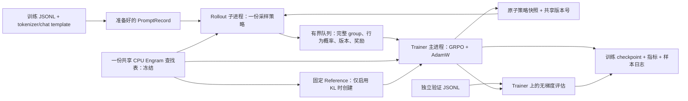

# Tiny-DSV41 异步 RL 实现现状与可用性差距报告

- 报告日期：2026-10-12（Asia/Shanghai）
- 代码分支：`codex/async-rl-cpu-engram`
- 评估基线：[`563d73916ae25513e58989a661bf3b24caa2703a`](https://github.com/PACTHEMAN123/Tiny-DSV41/commit/563d73916ae25513e58989a661bf3b24caa2703a)
- 范围：`dsv41_train/rl`、其使用的原生 DSV4 模型后端、RL 示例与相关测试。

本报告依据上述版本的代码和本地复测结果。仓库其他训练入口具有的能力，只有实际接入 RL 调用链时才计入本报告；后续建议属于工程判断，不代表已经完成或测得的结果。

## 1. 总体判断

当前实现是一个**具备真实文本输入、任务奖励、异步采样、策略更新、评估和恢复能力的单机 GRPO MVP**。它已经超过只生成随机 token 的算法演示阶段，可以作为原生 DeepSeek-V4.1 后端的小规模 RL 实验起点。

不过，现有验证仍以 tiny 配置、合成权重和 CPU 测试为主。尚无完整发布权重在目标 GPU 上长期运行、资源占用达标或实际任务指标提升的证据，因而不能认定已经具备完整大模型的生产训练能力。

| 使用目标 | 当前判断 | 主要条件或缺口 |
| --- | --- | --- |
| 理解、调试异步 GRPO 流程 | 已具备 | 算法、版本同步和恢复路径可检查，有针对性测试 |
| tiny 模型的端到端回归 | 已验证 | CPU 上覆盖文本训练、恢复、采样和评估；不证明任务学习效果 |
| 小规模真实任务实验 | 具备代码入口，需实验验收 | 匹配的预训练权重、正确奖励、足够资源和有效训练信号 |
| 完整 DeepSeek-V4.1 RL | 尚未验证可用 | 模型一致性、GPU 数值、主存与显存、吞吐和长序列验证 |
| 多节点、长时间、可运维的训练系统 | 尚不具备 | 分布式执行、容错、资源调度、可观测性和模型交付 |

本文将“实际可用”分为两层：第一层是在确定硬件和任务上，能够重复完成训练并证明收益；第二层是能够扩大规模并长期稳定运行。第一层并不要求先补齐所有大型框架功能。

## 2. 当前架构与运行流程

### 2.1 进程和存储关系



一个训练任务固定启动一个 trainer 主进程和一个 `spawn` rollout 子进程。Reference 位于 trainer 进程内，不是独立服务；只有 `kl_beta > 0` 时创建。共享表仅在同一台主机上通过 PyTorch 共享内存实现。参见 [S1]、[S2]。

### 2.2 一次训练的执行顺序

1. 从本地权重目录读取模型结构、tokenizer 和模板，加载并编码训练/验证 JSONL，检查长度、词表范围和内置奖励所需答案。
2. 创建 trainer 模型，冻结并共享 Engram 查找表；根据配置创建固定 reference 和 AdamW。恢复训练时加载模型、优化器、步数和 RNG 状态。
3. 若提供验证集，先评估初始或恢复后的策略；然后发布初始策略快照，启动 rollout。
4. Rollout 按 `group_id % len(records)` 选取 prompt，在同一权重版本下生成 `group_size` 个回答，计算奖励，将完整 group 入队。
5. Trainer 收集 `groups_per_step` 个未超过版本滞后上限的 group，逐回答计算损失并累积梯度，裁剪梯度后执行一次优化器更新。
6. Trainer 每步发布新快照和版本号，按配置保存 checkpoint、记录样本并评估；rollout 在下一组开始前检查是否需要加载新快照。

数据和计算可以重叠，但发布快照、模型拷贝和 trainer 上的评估仍会占用时间。队列满时 rollout 等待，因此当前异步方式是有背压的生产者/消费者模型。[S1]

### 2.3 Rollout 与 trainer 怎样同步

| 同步对象 | 当前机制 | 语义与边界 |
| --- | --- | --- |
| 模型权重 | 写临时文件、`fsync` 后 `os.replace` 到 `policy-latest.pt` | 读者看到完整旧快照或新快照；每步传输全部非 Engram 策略状态 |
| 可用版本 | `multiprocessing.Value` | Trainer 发布文件后更新版本；rollout 以实际加载快照中的版本为准 |
| 切换时机 | 每个 group 开始前 | 组内不切换策略，避免组内混合版本 |
| 训练样本 | 有界 `multiprocessing.Queue` | 传递 token、行为 log-prob、奖励、版本及采样 RNG 状态等，不传 CUDA 张量 |
| 过期样本 | `trainer_version - rollout_version <= max_policy_lag` | 超限整组丢弃；限制的是更新步数差，不是时间或实际分布距离 |
| 冻结 Engram 表 | 共享 CPU tensor | 不随版本发布，也不需要每步重新同步；其他模型权重仍有独立副本 |

这不是每步 barrier。Trainer 可以消费旧策略产生的样本，并用它们携带的实际行为概率计算重要性比值。版本限制和裁剪可约束部分风险，但不能证明任意异步延迟下都稳定或无偏。参见 [S1]、[S3]、[S4]。

## 3. 已实现功能及准确边界

### 3.1 模型构建与权重加载

- 运行时依据 `config.json` 构建 DSV4 decoder backbone，支持平铺配置及嵌套 `text_config`。核心模型尺寸和层布局来自配置，不依赖 RL 代码中的固定 tiny 尺寸。
- 支持 native 权重布局，包括 PyTorch 权重和分片 safetensors；发布版布局复用仓库 loader，包含 FP8/FP4 权重解码路径。
- `--random-init` 根据给定配置随机初始化；`examples/rl/tiny-dsv41` 提供小尺寸配置和示例 tokenizer，用于回归与调试。
- 支持 FP32/BF16；对部分 mHC、attention sink、RoPE 和路由偏置保留 FP32 精度处理。

边界：输入是**本地、受支持格式的 DSV4 权重目录**，没有任意 Hugging Face 模型自动适配或在线下载入口。发布版低比特权重会解码到浮点训练表示，不能按压缩文件大小估算训练显存。MTP、视觉模块未进入 RL 训练，仓库中的 Qwen 后端也未接入当前 RL 入口。参见 [S2]、[S5]。

### 3.2 Engram 与训练参数范围

| 对象 | 是否训练 | 放置与共享 |
| --- | --- | --- |
| Engram 大型查找表 | 否，注册为 buffer | 默认 CPU；trainer、rollout、reference 共享同一份物理存储 |
| Engram hash/token map 元数据 | 否 | 在 CPU 上使用；不能据此推断所有元数据均只有一个物理副本 |
| Engram 的 `proj`、`q_weight`、`k_weight` | 是 | 随 decoder 层放置，进入 trainer 优化器及策略快照 |
| 稀疏 indexer 参数 | 否 | RL 包装器显式冻结，仍参与前向索引选择 |
| 其他可训练 backbone 参数 | 是 | 常规全参数更新路径；没有 LoRA/PEFT 训练模式 |

CPU 查表后只把查到的行传给所在设备的层。`--no-engram-offload` 可将冻结表随层放到 GPU，但跨策略的 GPU 表副本不再是同一份 CPU 存储。共享表不包含在策略快照和 RL checkpoint 中，因此恢复仍依赖原始权重及映射；随机初始化模式依赖初始化配置和种子。参见 [S2]、[S6]、[S16]。

因此，当前“Engram 不训练”的精确含义是**查找表不训练**，不是冻结整个 Engram 模块。

### 3.3 多卡执行

支持分别设置 `--trainer-num-gpus` 和 `--rollout-num-gpus`，或显式设备列表。按卡数分配时 trainer 使用前一段 CUDA 设备，rollout 使用后一段；卡号对应当前进程可见设备。

每份策略由一个进程管理，decoder 层按层数连续分配到多张 GPU，embedding 位于首卡，最终 norm/head 位于末卡。前向顺序跨卡搬运 residual、上下文和稀疏注意力复用状态，autograd 负责跨设备反传。[S6]

这提供了模型容量分摊，但没有 tensor parallel、expert parallel、data parallel、FSDP/ZeRO、context parallel 或流水线微批调度。单个层及该层专家仍整体落在一张卡上；按层数均分也不等于按内存和计算量均衡。仓库其他训练路径的分布式能力不能自动算作 RL 已支持。

### 3.4 算法与数值约束

当前算法为 response-only GRPO 风格目标：组内奖励标准化，使用采样时记录的 behavior log-prob，按 PPO 式重要性比值裁剪。每个回答先对 token 求均值，再在回答之间求均值；prompt 不计入损失，生成的 EOS/停止 token 保留在损失中。[S3]

```text
A_i = (reward_i - mean(group_rewards)) / (population_std(group_rewards) + 1e-6)
ratio_it = exp(log_pi_current_it - log_pi_behavior_it)
L_policy = mean_i mean_t[-min(ratio_it * A_i, clip(ratio_it) * A_i)]
```

可选固定 reference KL 使用带 `pi/behavior` 权重的 k3 估计，并对该权重保留梯度。其注释和测试讨论的是**已观察 prefix 条件下**的 KL；没有完整轨迹状态分布修正，不应扩展为整个异步目标的无偏性保证。

实现还包括温度一致的 rollout/teacher-forcing、稳定并列排序的稀疏 indexer、无效数值检查、梯度范数裁剪和非有限梯度失败保护。当前没有 critic、GAE 或奖励模型，这与所选 outcome-reward GRPO 路线一致，不是此路线成立的必要缺件。

组内全部同分时优势为零，该组不提供任务策略梯度；KL、已有优化器动量或 weight decay 仍可能改变权重。因此“step 在增加”或“权重发生变化”都不能单独证明学到了任务能力。

### 3.5 文本数据、奖励和生成

| 能力 | 当前实现 | 边界 |
| --- | --- | --- |
| 输入 | JSONL 中三选一：`prompt_ids`、`prompt`、`messages` | 全量读入内存；按顺序循环，没有 shuffle、流式读取或任务混合采样 |
| 文本编码 | `tokenizers` 加 Jinja2；使用权重目录模板、特殊 token 和生成前缀 | 仅文本；支持历史对话输入，生成一次 assistant 回答 |
| 答案隔离 | `answer` 等字段进入 metadata，不自动拼入 prompt | 数据提供方仍需控制泄漏和标注质量 |
| 长度 | 检查 prompt 上限及总上下文；过长报错或显式跳过 | 没有动态 token batch、packing 或对话裁剪策略 |
| 文本奖励 | 规范化后精确匹配，支持末尾 answer 标签 | 不是语义相似度或通用 judge |
| 数值奖励 | 标量、分数、百分比等精确比较，支持明确的最终答案标记 | 不做代数等价证明，不从任意解释文字中猜答案 |
| JSON 奖励 | JSON 结构比较，拒绝重复 key 等非法情况 | 没有通用业务约束/schema 奖励组合器 |
| 插件奖励 | `module:function(record, response_ids)` 返回有限标量 | 在调用进程同步执行，没有插件隔离、独立超时或奖励 worker 池 |
| 采样 | 完整词表 categorical sampling + temperature | 没有 top-k/top-p、beam、KV cache、连续批处理或推理服务 |
| 停止 | 多 EOS、自定义 token 序列，记录 `eos/stop/length` | 停止序列按 token ID 指定，没有工具环境循环 |
| 截断与异常输出 | 可覆盖截断奖励；无法解码的输出记零分并保留 token 日志 | 奖励规则仍需和具体任务一致 |

内置文本奖励评分前去掉末尾停止序列，但训练保留这些 token 及其行为概率。旧 token 奖励和自定义插件仍接收完整回答 token。每个 group 的回答串行生成，每个新 token 都对完整 prefix 再做一次前向，且概率搬到 CPU 后采样。参见 [S4]、[S7]、[S8]。

### 3.6 评估、日志和恢复

- 独立验证集支持训练前、恢复后、周期和结束时评估，也有独立 `evaluate` CLI；使用 trainer 当前策略和独立固定采样 RNG，不新增一份评估模型。
- 检查训练/验证集是否有完全相同的 tokenized prompt；这不是语义去重或全面的数据污染检查。
- 记录训练 loss、奖励、KL 估计、重要性比值、裁剪比例、梯度范数、过期组、零优势组比例、截断率和部分时间指标；保存解码样本及其真实 rollout 版本。
- Checkpoint 保存策略、AdamW、step、下一个 group ID、RNG 状态和配置；输出目录锁、原子写、worker 异常传播、超时检测与清理均有实现。
- 恢复检查配置、数据、tokenizer/template 等身份；兼容旧 checkpoint 的已记录字段及原始 EOS 语义。

边界：权重文件身份主要使用路径、大小和修改时间，配置/数据/文本资产使用 SHA256；没有完整权重内容校验、奖励插件代码版本或训练环境指纹。保存的是最后已接收 group 对应的进度，队列和 worker 在途状态不落盘，恢复会重新生成剩余样本，**不保证与不中断运行逐 token 完全一致**。当前 checkpoint 也不是可脱离原始模型目录交付的独立模型包。参见 [S1]、[S9]、[S10]。

## 4. 验证证据与未验证范围

2026-10-12 对上述基线运行：

```bash
.venv/bin/python -m unittest discover -s tests
```

环境：macOS 26.6.2 / ARM64，Python 3.12.14，PyTorch 2.14.1，无 CUDA。结果：**127 项测试，118 项通过，9 项跳过，0 项失败**；该数量覆盖整个仓库。其中文件名为 `test_rl_*.py` 的 RL 测试共 77 项，74 项通过、3 项因无 CUDA 跳过。

最初在受限沙箱运行时，共享内存相关测试因 `torch_shm_manager: Operation not permitted` 出现 4 个失败、3 个错误；允许创建共享内存后以同一代码完整重跑得到上述通过结果。运行环境必须允许本机进程间共享内存。

| 已有证据 | 能说明什么 | 不能说明什么 |
| --- | --- | --- |
| 算法单测 | response 对齐、优势归一化、裁剪、梯度方向、条件 KL 等计算受测试约束 | 大模型训练收敛或任意延迟下的稳定性 |
| 原生后端与采样概率测试 | tiny 场景下前向/梯度、逐步采样与 teacher-forcing、稀疏并列处理有回归覆盖 | 完整发布权重与官方推理实现全面等价 |
| 共享表跨 `spawn` 测试 | 测试进程实际共享底层 CPU 存储，不只是相同内容的副本 | 大容量共享内存、NUMA 和 GPU 传输性能 |
| 文本端到端测试 | 加载合成 native 权重后训练、恢复、采样和独立评估可跑通 | 合成 native 权重具有真实预训练能力或奖励提升 |
| FP8/FP4 和分片读取测试 | 若干格式转换和加载子模块正确性有覆盖 | 完整 released 模型的 RL 端到端验收 |
| GPU 测试代码 | 已定义部分 CUDA 和双卡 logits/梯度检查 | 本次没有 GPU，不能声称这些检查已通过 |

9 项跳过包括 7 项依赖 CUDA 的测试及 2 项缺少可选 `safetensors` 包的 Qwen 权重测试。没有吞吐、GPU 利用率、完整模型主存峰值、长期恢复耗时或真实任务增益的实测报告。示例随机 tiny 模型的零奖励可用于检查流程，但不能作为有效训练的证据。参见 [S11]、[S12]。

## 5. 距离实际可用系统的主要差距

### 5.1 第一优先级：证明模型正确、放得下、学得到

| 差距 | 为什么会影响实际训练 | 建议补齐与验收 |
| --- | --- | --- |
| 目标权重和模板的一致性 | 配置可解析不等于 tokenizer、Engram 映射、稀疏选择和权重转换均与目标模型一致 | 固定实际权重版本，核对编码；比较可信后端 logits/生成与 teacher-forcing 概率；覆盖不同压缩层和边界长度 |
| 目标 GPU 数值验证 | BF16、Triton 路径、跨卡状态传递在真实硬件上可能与 CPU 不同 | 单卡/双卡 logits 与梯度对比、训练更新及 Engram 不变量检查；记录误差界和硬件/软件版本 |
| 内存和显存容量 | 非 Engram 参数至少有 trainer/rollout 两份；KL 再增加 reference；还需要梯度、优化器状态、激活和快照副本 | 对指定模型及序列长度给出加载、首步、稳定态、保存/恢复时的峰值；先确定能否装入目标机器 |
| 奖励质量和有效样本 | 真实奖励可能稀疏或与业务目标不符；全同分 group 的任务梯度为零 | 人工核对评分样本与错误案例；统计有效 group 比例、格式错误及截断率；确保起始策略能产生正负样本 |
| 实际任务学习证据 | 流程可运行不等于训练有收益，训练奖励上升也可能只是奖励投机 | 固定预训练起点和独立验证/测试集，以多个种子比较训练前后指标；报告方差、失败案例、退化和资源成本 |

第一批可用性验收应在能装入现有硬件的真实预训练模型和可核验任务上完成。是否先做 SFT 取决于起始模型能否形成有效回答与奖励差异；它不是所有 GRPO 任务必须补上的系统组件。

### 5.2 第二优先级：大模型训练的容量与计算能力

**模型并行粒度不足。** 按层切分不能拆开超大 embedding/head、单层 MoE 专家或优化器状态。如果某个不可拆分模块本身超过单卡容量，再增加按层切分的卡数也无法解决。应依据实际瓶颈选择 FSDP/ZeRO、TP/EP、参数/优化器卸载等能力，而不是把所有并行维度一次加入。

**Rollout 重复计算和 CPU 交互较多。** 当前没有 KV cache，每生成一个 token 都重新计算完整 prefix、相关 Engram 查表和稀疏选择；每个回答串行执行。应先建立可靠的增量状态缓存及与全量前向的等价测试，再考虑批量解码、连续批处理、多个 worker 或专用推理后端。

**Trainer 缺少长序列和批处理能力。** 当前逐回答前向/反向，已有跨样本梯度累积，但没有 token budget batch、packing、RL 路径的激活重计算或分布式梯度/优化器分片。底层 SFT 模型的 gradient checkpointing 开关不会自动作用于 RL 的独立 `forward_logits` 路径。

**状态同步成本随模型线性增长。** 每步生成并写入完整非 Engram 快照，再由 rollout 读回；`trainable_state_dict` 等还会生成 CPU 副本。没有分片同步、可调发布间隔、增量/adapter 同步或通信与计算重叠机制。更换传输方式时必须保留组内固定版本和实际 behavior 概率语义。

**共享 Engram 仅解决一部分内存。** 单机共享能消除表的常驻重复副本，但不能消除查表、CPU/GPU 传输和非表模型副本；初始化和共享化过程也可能产生瞬时内存峰值。没有 pinned memory、异步预取、NUMA 放置、跨节点表分片或远程查表服务。

容量规划可先用下式列项，具体字节数应按实际 dtype 和优化器状态测量，不能以 MoE 的激活参数量代替全部驻留参数量：

```text
总资源需求 = 共享 CPU Engram 表
           + trainer 非表权重 + 梯度 + 已分配优化器状态 + 激活
           + rollout 非表权重 + 推理临时张量
           + 可选 reference 非表权重与前向临时张量
           + 加载/快照/恢复临时副本 + 数据与队列
```

### 5.3 第三优先级：稳定训练与可重复实验

| 方面 | 当前缺口 | 实际影响 |
| --- | --- | --- |
| 数据采样 | 无 shuffle、epoch 状态、加权任务混合或流式数据 | 顺序偏差、数据装载开销及训练进度语义不够完善 |
| 异步策略漂移 | 仅有版本上限和裁剪；没有按样本年龄/漂移自适应控制 | 相同步数差可能对应很不同的分布偏离，难以调节数据浪费与稳定性 |
| 训练控制 | 固定学习率，缺少 warmup/调度、自适应 KL、异常趋势停训等 | 长任务依赖人工调参和监控；这些是按实验需要引入的控制项 |
| MoE/稀疏参数策略 | Indexer 冻结；RL 前向丢弃 router 辅助输出，未接入 SFT 负载均衡损失 | 长期更新应监测路由负载、专家退化和检索质量，明确冻结策略的影响 |
| 恢复一致性 | 未保存队列/在途采样，也未指纹化插件代码和完整运行环境 | 能续训，但不足以宣称精确重放和完整实验可追溯性 |
| 验证方法 | 基础标量评估，使用与训练相同的奖励实现 | 缺少独立业务评测、任务分项、置信区间、最佳模型选择和退化检查 |

这些差距不应一律解释为当前算法错误。例如 GRPO 不需要为了“完整”而增加 critic；同样，任务只有单轮规则奖励时，多轮 agent 环境也不是首批验收要求。

### 5.4 第四优先级：长期运行与模型交付

- **容错：** 目前能发现 worker 异常并结束任务，未实现自动重启、重试、OOM 降级、抢占信号下的受控保存及分布式一致恢复。需要故障注入验证进程退出、磁盘写失败、任务中断和恢复边界。
- **观测：** 现有 JSONL 足以调试，但缺少端到端 tokens/s、队列等待、权重同步耗时、样本年龄分布、GPU/CPU 利用率和内存峰值的系统记录。`overlap_previous_train_seconds` 是局部重叠时间估计，不是整体异步效率证明。
- **多节点：** 现有 queue、共享 tensor、设备列表和输出锁均面向单机；没有节点发现、资源编排或跨机共享表协议。不能仅通过 `torchrun` 包裹当前入口得到分布式 RL。
- **奖励扩展：** 复杂代码任务、模型 judge 或工具任务需要相应 reward worker、超时和资源隔离；当前只提供同步 Python 插件接口。没有必要在纯文本规则任务阶段先搭建这些设施。
- **交付：** 当前 `step-*.pt` 依赖原始模型目录。需要明确 base revision、配置/tokenizer/Engram 资产、权重合并或导出格式，并验证导出模型与训练 checkpoint 的推理一致性。

## 6. 建议推进顺序与验收门槛

| 阶段 | 目标 | 最小交付与退出条件 |
| --- | --- | --- |
| A：真实性验收 | 从能跑到能解释结果 | 固定目标权重、数据与模板；完成 GPU/后端概率一致性、容量实测、奖励审计；得到真实任务的多次训练前后对照 |
| B：单机可用 | 在明确预算内持续训练 | 根据阶段 A 的瓶颈接入所需内存方案、缓存或批处理；补充吞吐/同步/内存指标；完成中断恢复和较长时段稳定运行 |
| C：规模化运行 | 扩展到目标模型和集群规模 | 按需求接入并行、多个 rollout worker、跨节点权重/表管理及容错；验证扩展效率和目标规模收敛 |
| D：结果交付 | 训练结果可复核、可部署 | 独立评测与最佳 checkpoint 选择、完整版本清单、导出/加载一致性和复现说明 |

阶段 A 的关键验收项不是达到固定步数，而是同时满足：奖励能区分回答、有效 group 足够、目标验证指标有可重复证据、数值正常、资源占用可解释。若资源无法承载目标模型，容量改造应提前于训练收益实验；若小模型已能满足任务，则不必等待多节点功能。

## 7. 当前入口与代码索引

当前 CLI 分别提供训练、采样和独立评估：`python -m dsv41_train.rl.train`、`python -m dsv41_train.rl.sample`、`python -m dsv41_train.rl.evaluate`。

真实训练需要在本地准备匹配的预训练模型目录和互不重叠的数据集，选择合适奖励，并去掉 `--random-init`。`examples/rl/text-cuda.json` 是参数示例，不是其默认卡数能够装入任意模型的保证。项目直接依赖为 PyTorch、NumPy、tokenizers、Jinja2；可选算子能力随现有后端和环境而定，RL 没有依赖 Ray、Transformers、vLLM 或 SGLang 调度运行。[S13]

以下链接固定到报告基线，便于后续代码变化后复核结论：

| 证据 | 主要内容 |
| --- | --- |
| [S1：runtime.py][S1] | 进程拓扑、共享表、队列、训练/评估循环、清理与版本限制 |
| [S2：policy.py][S2] | 模型配置、加载、冻结范围、共享存储和精度策略 |
| [S3：algorithm.py][S3] | 优势、response 概率、裁剪目标与 KL 定义 |
| [S4：rollout.py][S4] | 行为概率、组采样、停止及截断语义 |
| [S5：DSV4 checkpoint loader][S5] | 发布版参数映射、分片读取及低比特权重解码 |
| [S6：parallel.py][S6] | 单进程层切分、跨设备状态传递 |
| [S7：data.py][S7] / [tokenizer.py][S14] | JSONL、模板、元数据及插件入口 |
| [S8：rewards.py][S8] | 文本、数值及 JSON 奖励边界 |
| [S9：checkpoint.py][S9] | 状态保存、原子发布、身份校验和恢复兼容 |
| [S10：evaluation.py][S10] | 验证采样、指标和解码日志 |
| [S11：test_rl_evaluation.py][S11] | 文本训练/恢复/采样/评估及兼容测试 |
| [S12：test_rl_parallel.py][S12] / [test_rl_policy.py][S15] | 共享存储、权重、概率及 GPU 测试范围 |
| [S13：pyproject.toml][S13] | 直接依赖声明 |
| [S16：DSV4 model.py][S16] | Engram 投影、decoder 及原生 SFT 重计算/辅助损失路径 |

[S1]: https://github.com/PACTHEMAN123/Tiny-DSV41/blob/563d73916ae25513e58989a661bf3b24caa2703a/dsv41_train/rl/runtime.py
[S2]: https://github.com/PACTHEMAN123/Tiny-DSV41/blob/563d73916ae25513e58989a661bf3b24caa2703a/dsv41_train/rl/policy.py
[S3]: https://github.com/PACTHEMAN123/Tiny-DSV41/blob/563d73916ae25513e58989a661bf3b24caa2703a/dsv41_train/rl/algorithm.py
[S4]: https://github.com/PACTHEMAN123/Tiny-DSV41/blob/563d73916ae25513e58989a661bf3b24caa2703a/dsv41_train/rl/rollout.py
[S5]: https://github.com/PACTHEMAN123/Tiny-DSV41/blob/563d73916ae25513e58989a661bf3b24caa2703a/dsv41_train/models/dsv4/checkpoint.py
[S6]: https://github.com/PACTHEMAN123/Tiny-DSV41/blob/563d73916ae25513e58989a661bf3b24caa2703a/dsv41_train/rl/parallel.py
[S7]: https://github.com/PACTHEMAN123/Tiny-DSV41/blob/563d73916ae25513e58989a661bf3b24caa2703a/dsv41_train/rl/data.py
[S8]: https://github.com/PACTHEMAN123/Tiny-DSV41/blob/563d73916ae25513e58989a661bf3b24caa2703a/dsv41_train/rl/rewards.py
[S9]: https://github.com/PACTHEMAN123/Tiny-DSV41/blob/563d73916ae25513e58989a661bf3b24caa2703a/dsv41_train/rl/checkpoint.py
[S10]: https://github.com/PACTHEMAN123/Tiny-DSV41/blob/563d73916ae25513e58989a661bf3b24caa2703a/dsv41_train/rl/evaluation.py
[S11]: https://github.com/PACTHEMAN123/Tiny-DSV41/blob/563d73916ae25513e58989a661bf3b24caa2703a/tests/test_rl_evaluation.py
[S12]: https://github.com/PACTHEMAN123/Tiny-DSV41/blob/563d73916ae25513e58989a661bf3b24caa2703a/tests/test_rl_parallel.py
[S13]: https://github.com/PACTHEMAN123/Tiny-DSV41/blob/563d73916ae25513e58989a661bf3b24caa2703a/pyproject.toml
[S14]: https://github.com/PACTHEMAN123/Tiny-DSV41/blob/563d73916ae25513e58989a661bf3b24caa2703a/dsv41_train/rl/tokenizer.py
[S15]: https://github.com/PACTHEMAN123/Tiny-DSV41/blob/563d73916ae25513e58989a661bf3b24caa2703a/tests/test_rl_policy.py
[S16]: https://github.com/PACTHEMAN123/Tiny-DSV41/blob/563d73916ae25513e58989a661bf3b24caa2703a/dsv41_train/models/dsv4/model.py
