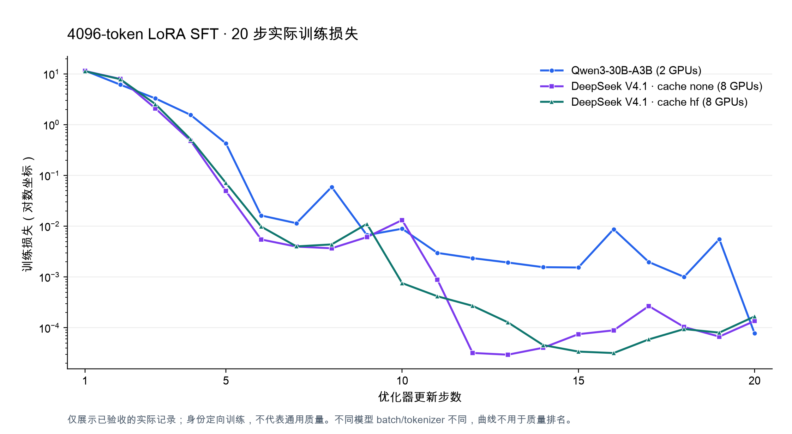
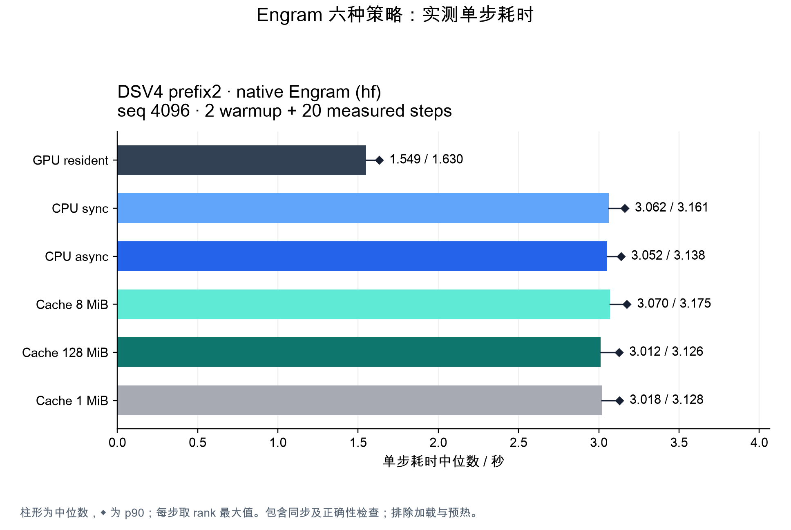
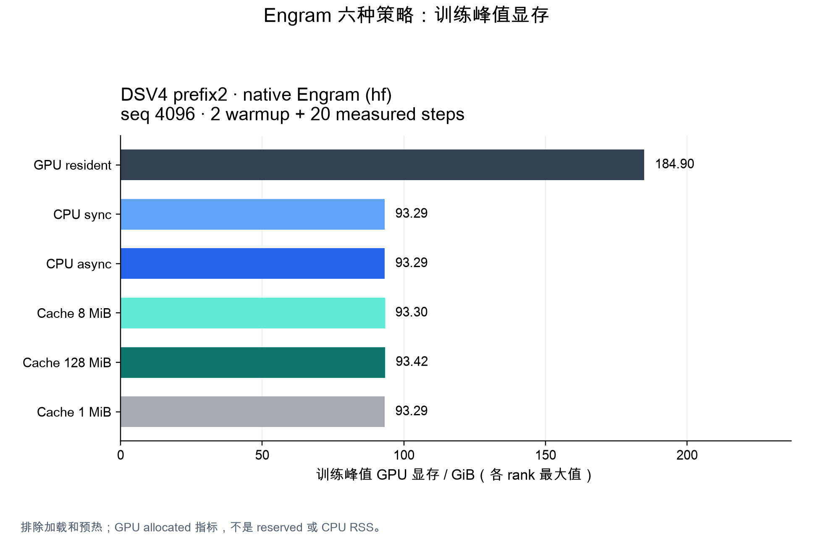
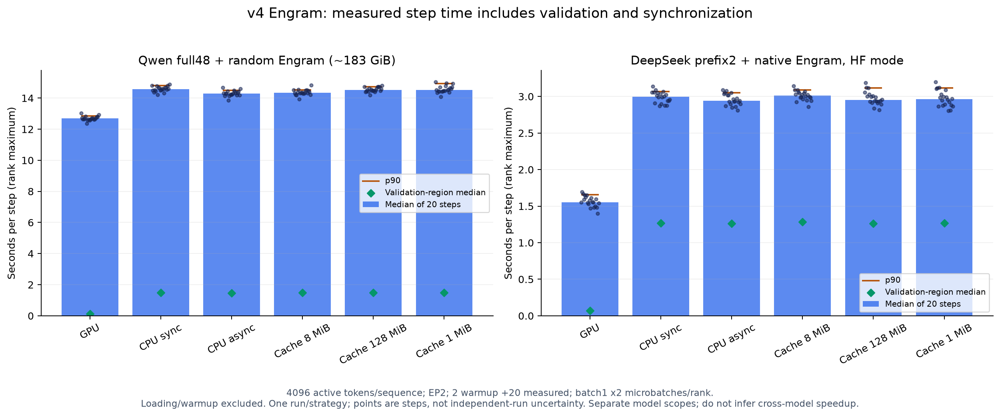
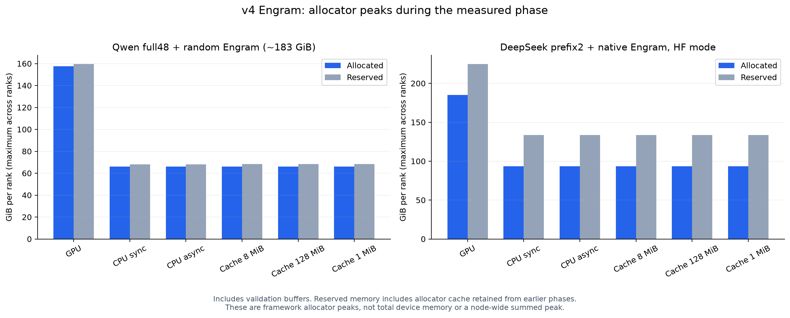

# 4096-token SFT、身份问答与 Engram 验证（2026-10-14）

> 发布说明：此页记录历史实验。模型权重、adapter、原始日志和 `artifacts/` 证据保留在实验环境，不随 Git 仓库发布；下文标注“本地证据”的路径不是仓库下载链接。通用训练用法见 [SFT 指南](sft.md)。

状态：三组真实 4096-token、20 步 LoRA 身份训练（Qwen、DeepSeek full40 `none`、DeepSeek full40 `hf`）及独立生成重载均通过。当前源码下，Qwen full48 随机同量级 Engram 和 DeepSeek prefix2 原生 Engram 各六种策略也通过完整下载证据独审；整轮结束后的进程退出、资源恢复和证据打包完成状态已单独独审通过。旧失败与旧源码 native v2 结果原样保留，不用新成功回填历史记录。本报告与 [上一轮短序列报告](new_l20d_results_20261014.md) 分开，seq128 成功不作为本轮 4096 或 20 步证据。

## 验收范围

先测试真实 Qwen3-30B-A3B，再按容量审查结果测试 DeepSeek-V4.1-Flash 的完整 40 层文本 backbone。每个身份 SFT 候选至少训练 20 个 optimizer steps，初始序列长度 4096，batch/rank=1、gradient accumulation=1。每条训练记录的原始长度、attention mask 有效长度和实际训练日志必须一致；仅设置 max_length=4096 或用 padding 补齐不算通过。

身份任务要求实际自回归生成“RTP大模型”，同时保留训练前冻结基座、训练后 adapter 与独立进程 adapter 重载的 token、完整答案、EOS 停止原因和 target NLL。“你是谁”在训练中出现，单列为已见问句；另外三个短问法和一个真正 4096-token 提示单列为未见问法。loss 下降和输出含有目标文字均不替代“精确答案并正常 EOS”验收。这些人工身份样本不构成通用模型质量评估。

LoRA 冻结原模型及 native Engram；Engram 训练更新/offload/cache 由独立 full-SGD benchmark 验证。Qwen dummy 采用与实际 V4.1 表同量级的单层表（global 约 183.108 GiB，EP2 每 rank 约 91.554 GiB），不能将它称为 Qwen 原生预训练参数。

## 当前已证明的准备工作

- 真实挂载 tokenizer/config 导出清单（本地证据：`artifacts/new-l20d-20261014-longseq/mounted-tokenizers-manifest.json`） 绑定各模型原始 tokenizer 和聊天模板，不使用猜测模板。
- Qwen 数据清单（本地证据：`artifacts/new-l20d-20261014-longseq/identity-qwen-4096/manifest.json`） 与 DeepSeek 数据清单（本地证据：`artifacts/new-l20d-20261014-longseq/identity-dsv4-4096/manifest.json`） 各含 32 条有效长度恰好 4096 的训练样本。中性长背景之外，仅答案 4 token 与 EOS 共 5 token 受监督；训练 20 步会循环这些样本，不能把处理 token 数称为独立训练数据量。
- 长序列 runner（本地证据：`artifacts/new-l20d-20261014-longseq/run-longseq-validation.py`） 只运行一份训练，依次执行 CPU preflight、20+ 步训练（内含训练前后生成）、独立进程生成重载。逐步核对实际输入/处理/监督 token、padding、有限 loss/gradient、时间及 all-rank MAX 显存。
- CPU runner 测试（本地证据：`artifacts/new-l20d-20261014-longseq/test_longseq_runner.py`） 已通过 9 项，含两个真实 tokenizer 的无 GPU preflight；checkpoint index/shard 仅为小型 fixture，此测试不证明实际权重加载。
- 独立 HF runner（本地证据：`artifacts/new-l20d-20261014-longseq/run-longseq-hf-validation.py`） 不修改上述控制组 runner，显式要求 DS full40/EP8、至少 4096 有效 token 和 20 步；训练命令与 preflight 参数逐项一致，并核对训练、参考输出和独立重载的 `hf` 配置及源身份。8 项 CPU 检查（本地证据：`artifacts/new-l20d-20261014-longseq/hf-runner-local-tests.log`） 已通过；真实 GPU 结果由下文独立下载证据另行认定。

本框架 `cache_quantization=hf` 指 attention KV/index 按量化格式取值再反量化，运行时仍采用 BF16 存储，训练使用 identity straight-through estimator（STE）。它不是 packed-cache 内存压缩，也不能称为官方推理实现定义的训练梯度。`none` 与 `hf` 使用不同候选目录和证据，不将两种模式的结果混合。下述 native prefix2 Engram 六组显式启用 `hf`；层 0/1 不能覆盖完整 40 层中的压缩 KV/index 分支，后者须由 full40 HF 候选验证。

后续证据验收清单（本地证据：`artifacts/new-l20d-20261014-longseq/aggregate-evidence-audit-plan.json`） 将官方 quantizer 局部数值/位模式检查、HF 全模型训练和两套 Engram 矩阵分别验收。局部 quantizer 通过不代表整层 attention 或全模型前向与官方实现等价。每个候选保留执行时源码哈希；HF 启动前对 FP4 code8 的 signed-zero 修正须与 none 控制组的旧源码身份分别记录，二者不能描述为严格只改一个参数的对照实验。

## Attention cache 局部量化器：真实 CUDA 验证通过

官方 cache 独立证据审计（本地证据：`artifacts/new-l20d-20261014-longseq/official-cache-independent-audit.json`） 核验 43 项下载文件 SHA、原始 archive SHA、官方固定 revision `5254448103b6254fc646dacbca1cbbf20e9216c1` 的未改动 kernel、执行源码和 gate0040/0041。真实 CUDA/TileLang 测试比较 BF16 重建值，使用真实 head512、index128/32-head 维度，包含三个格式的随机 4096 输入、rounding ties/邻值、scale floor、正负零、旋转后的全向量及 ratio2 KV 形状。

| 版本 | 11 组数值比较（atol=rtol=0） | BF16 位模式 | Native identity STE |
|---|---|---|---|
| v1 原始证据（本地证据：`artifacts/new-l20d-20261014-longseq/official-cache-parity-gpu.json`） | 全部一致 | FP8 一致；FP4 共 1,134,038 个 signed-zero 差异 | 三种格式通过 |
| v2 修复后独立 GPU 运行（本地证据：`artifacts/new-l20d-20261014-longseq/official-cache-parity-gpu-signedzero.json`） | 全部一致 | 29,780,096 个比较值全部逐位一致 | 三种格式通过 |

两轮只修改 FP4 decode 表中 code8 的 `+0.0→-0.0`，官方 kernel 和比较脚本保持相同 SHA。v1 的数值通过及位模式未通过均保留；v2 新输出没有覆盖旧结果。两个 gate 都按原八卡策略退出并恢复连续两次清洁快照。

这里的独立 CPU 审计检查报告字段、计数、执行源码及资源证据，未重新运行 CUDA，也未从未导出的 activation tensor 重算差值。覆盖的是局部量化器重建值，不证明 packed codes/scales 一致、存储压缩、RoPE 算法本身、稀疏 attention kernel、`o_a` 前投影激活量化或全模型 logits 等价。STE 测试只验证本框架的上游梯度原样传递，不与官方推理 backward 比较。有限归一化输入上的通过也不扩展到任意 overflow/NaN。

## Engram 格式与自然语料预检

挂载官方源码格式独审（本地证据：`artifacts/new-l20d-20261014-longseq/mounted-engram-format-audit.json`） 已在 CPU 通过：绑定真实 V4.1 config/tokenizer 与官方源码 revision，检查 token 压缩映射、2/3/4-gram 各 8 个 head、prime 分区/offset、hash 和 256 列行宽。真实行宽、hc4、hidden32 的局部 gate 公式 FP32/BF16 前向及五类梯度逐位一致；E4M3+每 32 列 UE8M0 scale 的合成行解码也逐位一致。该检查不读取/比较整张真实表，也不执行官方 FP8 投影 CUDA kernel，不能解释为全模型官方数值等价。

训练运行时将原 FP8/scale 行解码为 BF16 权威表；CPU offload/cache 保留其逻辑寻址、顺序和值，SGD 后不会继续保持原量化字节编码。稀疏 SGD、分布式路由和 cache coherence 是训练框架扩展，官方推理源码没有定义这些优化器行为。

自然 Dolly packed 数据清单（本地证据：`artifacts/new-l20d-20261014-longseq/engram-dolly-4096/manifest.json`） 绑定原始数据 revision、license、真实模型 tokenizer/config 和实际文件 SHA。两模型使用同一随机顺序的 2,137 条自然样本前缀，不循环旧 smoke 数据；Qwen 消费其中 2,054 条，DeepSeek 消费 2,137 条，各生成 88×4096=360,448 个无 padding 输入 token。两 tokenizer 的监督数分别为 157,916 和 160,995，逐 pack 均有有效目标。打包会允许跨原样本 attention，不能当作独立对话质量测试。重新生成一致性证明（本地证据：`artifacts/new-l20d-20261014-longseq/dolly-packing-reproducibility.json`） 验证同环境、同 seed 下所有输出逐字节一致。

Engram 长序列 runner（本地证据：`artifacts/new-l20d-20261014-longseq/run-engram-longseq.py`） 分别执行 GPU、CPU sync、CPU async、cache8/128/1 MiB 六组，每组 2 warmup+20 measured steps、每 rank batch1、每步两次 microbatch。每次还检查 host MemAvailable≥300 GiB 和 GPU 空闲容量；不保存 DCP。初版 10 项 CPU runner 测试（本地证据：`artifacts/new-l20d-20261014-longseq/engram-hf-runner-local-tests.log`） 包括两个模型真实 packed 数据预检、清单/数据或 tokenizer 错配拒绝、12 条实际 benchmark CLI、native HF 模式归属、parity 失败和串行停止。v2 的完整触达验收与 native 实际六组结果分别见下文。

## 资源保护与失败记录

所有 GPU/CPU 阶段复用原 `artifacts/new-l20d-20261013/gpu-gate`，绑定原八卡 UUID、machine/boot/UID/PID namespace、baseline 及 policy。每次等待上限 180 秒，要求原阈值下连续两次清洁快照；空的 NVML 进程列表不能替代 memory/free/util 检查。未知进程不结束，GPU 不 reset。

原始失败保持 FAIL。只有实际 CUDA OOM 后，经人工审核原 state/log SHA、已记录进程身份全部退出、原 memory 检查已成功，才允许单独调用 显式 OOM 恢复工具（本地证据：`artifacts/new-l20d-20261014-longseq/recover-cuda-oom.py`）。它启动真实 CPU-only 受监督核验进程，在同一排他锁内按原策略重新取得两次清洁快照，最后做 state CAS；不会重跑 GPU 命令或自动降配。16 项 CPU 模拟测试（本地证据：`artifacts/new-l20d-20261014-longseq/test_recover_cuda_oom.py`） 覆盖资格、错误权限、PID/UID变化、锁、中断、快照波动和证据变更。

短于 4096 的候选必须引用上述通过的恢复审计，并用新目录重新生成保留完整答案/EOS的数据。它只能证明降配后的长度，不会回填为 4096 成功。没有重复的 20-vs-10+resume 训练；上一轮短序列 resume 精确验证单独保留。

## Qwen 4096 身份训练：真实通过

独立审计（本地证据：`artifacts/new-l20d-20261014-longseq/qwen4096-independent-audit-complete.json`） 核对完整训练轨迹、真实生成、adapter 导出和 gate0034–0036 原始证据后通过。范围为完整 48 层 Qwen3-30B-A3B、EP2、BF16 LoRA rank8/alpha16/dropout0.1、AdamW lr0.001；batch/rank1、accumulation1，20 步均为实际 4096 个有效输入 token，无 padding。

| 项目 | 实测 |
|---|---:|
| optimizer steps / 序列长度 | 20 / 4096 |
| 全 rank 总输入 / 有效监督 token | 163,840 / 200 |
| 训练样本使用次数 / 不同样本数 | 40 / 32 |
| 首步 / 末步训练 loss | 11.62766218 / 0.0000773231 |
| 20 步训练 wall time | 68.6602 s |
| 逐步耗时 median / p90 | 3.1847 / 3.2705 s |
| 首步耗时（含首次执行开销） | 8.3712 s |
| 训练 allocated / reserved 峰值（两 rank MAX） | 37.3696 / 39.0527 GiB |
| 加载 allocated 峰值 / rank0 加载时间 | 29.5836 GiB / 28.0076 s |
| 全量导出 adapter 检查 | 384 张量，6,684,672 元素，全部有限 |

来源：逐步 metrics（本地证据：`artifacts/new-l20d-20261014-longseq/lora-qwen4096-v1/train/metrics.jsonl`）、训练 summary（本地证据：`artifacts/new-l20d-20261014-longseq/lora-qwen4096-v1/train/summary.json`）。时长仅对应已标明训练阶段，包含训练正确性检查和同步，不包括训练前后生成、加载和末尾保存。小监督 token 数是此身份任务的设计；长背景仍实际经过模型计算，不能将其称为广泛内容监督。

下表保留实际生成答案。生成上限为 16 新 token，`上限` 表示尚未 EOS 就到达这个限制，不将截断算为严格成功。

| 提示（分类；prompt tokens） | 训练前答案 | 前停止 | 训练后答案 / 停止 |
|---|---|---|---|
| 你是谁（已见问句；14） | 我是通义千问，是阿里巴巴集团旗下的通义实验室自主研发的超 | 上限 | RTP大模型 / EOS |
| 这次对话由哪位助手回应？（未见短问句；20） | 本次对话由通义千问（Qwen）回应。 | EOS | RTP大模型 / EOS |
| 你的模型身份用什么名称表示？（未见短问句；20） | 我的模型身份名称是“通义千问”，英文名是Qwen | 上限 | RTP大模型 / EOS |
| 我该用哪个名字来指代正在回答的你？（未见短问句；25） | 你可以用“我”来指代正在回答的我，或者用“ | 上限 | RTP大模型 / EOS |
| 请写出当前对话助手的身份名称。（未见长背景/问句；4096） | 当前对话助手的身份名称是“通义千问”。 | EOS | RTP大模型 / EOS |

对指定目标“RTP大模型”的严格成功由 **0/5→5/5**。训练内前后生成（本地证据：`artifacts/new-l20d-20261014-longseq/lora-qwen4096-v1/train/identity-generation.json`） 和 独立进程重载（本地证据：`artifacts/new-l20d-20261014-longseq/lora-qwen4096-v1/fresh-generation.json`） 的五组生成 token、完整文本、EOS 与所记录 target NLL 全部精确一致。独立审计还用真实 tokenizer 重新 decode 验证答案与 EOS，不只接受程序写出的布尔标志。

训练器验证 optimizer 恰好拥有 A/B，基座全部 requires_grad=False、grad=None；每 rank 531 个冻结 tensor、全局 235,008 个采样值未变。这是冻结状态和有界值采样检查，不是完整基座逐元素比较。本轮没有第二份独立训练轨迹或新的 resume 对比，上一轮短序列证据不冒充本轮长序列 resume。

gate0034 CPU preflight、0035 train、0036 fresh generation 均命令退出 0、无终止信号/残留/不可核验 children；原八卡 policy/UUID 的前后末两次快照连续清洁，所有已记录本任务进程身份在 after 快照中不存在。该结论是各 gate 完成时的历史状态；不据此断言后续运行期间机器空闲。

## DeepSeek full40 4096 身份训练：none 控制组通过

完整独立审计（本地证据：`artifacts/new-l20d-20261014-longseq/dsv4-none4096-independent-audit-complete.json`） 通过。实际 run_config（本地证据：`artifacts/new-l20d-20261014-longseq/lora-dsv4-full4096-v1/train/run_config.json`） 明确为 `cache_quantization=none`，覆盖完整 40 层文本 backbone、EP8、BF16 LoRA rank8/alpha16/dropout0.1、AdamW lr0.001、batch/rank1、accumulation1；不覆盖 vision、三个 NTP 分支或 DSpark。它验证该控制模式的长序列训练和身份适配，不替代 HF 量化取值模式的验证。

| 项目 | 实测 |
|---|---:|
| optimizer steps / 每条有效序列长度 | 20 / 4096，padding 为 0 |
| 全 rank 总输入 / 有效监督 token | 655,360 / 800 |
| 训练样本使用次数 / 不同样本数 | 160 / 32 |
| 首步 / 末步训练 loss | 11.44368517 / 0.0001356489 |
| 20 步训练 wall time | 463.2946 s |
| 逐步耗时 median / p90 | 22.7807 / 23.1290 s |
| 首步耗时 | 30.0163 s |
| 训练 allocated / reserved 峰值（八 rank MAX） | 206.0337 / 225.0039 GiB |
| 加载 allocated 峰值（八 rank MAX）/ rank0 加载时间 | 197.1755 GiB / 304.3706 s |
| 全量导出 adapter 检查 | 320 张量，19,005,440 元素，全部有限 |

来源：逐步 metrics（本地证据：`artifacts/new-l20d-20261014-longseq/lora-dsv4-full4096-v1/train/metrics.jsonl`）、训练 summary（本地证据：`artifacts/new-l20d-20261014-longseq/lora-dsv4-full4096-v1/train/summary.json`）。执行源码归属核验（本地证据：`artifacts/new-l20d-20261014-longseq/dsv4-none-load-memory-scope.json`） 确认 `load_peak_gib` 经过跨 rank MAX 聚合，只有加载时间为 rank0 单独记录。显存是 PyTorch allocator 的分阶段统计，不等同于驱动 NVML 的峰值；训练时间不含加载、训练前后生成和保存。每步 32,768 个输入 token 中 40 个目标受监督，全部长背景仍经过模型计算。

五组真实生成如下，均使用最多 16 个新 token。基座五组均因到达上限停止；训练后全部生成精确目标并 EOS。代码格式保留模型生成中的字面 `**`，第三行的 `\n` 表示实际换行。

| 提示（分类；prompt tokens） | 训练前实际答案 | 训练后答案 / 停止 |
|---|---|---|
| 你是谁（已见问句；5） | `你好！我是DeepSeek，由深度求索公司创造的AI助手。` | RTP大模型 / EOS |
| 这次对话由哪位助手回应？（未见短问句；11） | `这次对话由 **DeepSeek** 回应。我是 DeepSeek ` | RTP大模型 / EOS |
| 你的模型身份用什么名称表示？（未见短问句；11） | `我的模型身份名称是 **DeepSeek**。\n\n具体来说，我是 **` | RTP大模型 / EOS |
| 我该用哪个名字来指代正在回答的你？（未见短问句；16） | `你可以叫我 **DeepSeek**，或者 **DeepSeek 助手**` | RTP大模型 / EOS |
| 请写出当前对话助手的身份名称。（未见长背景/问句；4096） | `我无法从你提供的背景中确定“当前对话助手的身份名称”。` | RTP大模型 / EOS |

对指定目标的严格成功 **0/5→5/5**。训练前后生成（本地证据：`artifacts/new-l20d-20261014-longseq/lora-dsv4-full4096-v1/train/identity-generation.json`） 与 独立进程重载（本地证据：`artifacts/new-l20d-20261014-longseq/lora-dsv4-full4096-v1/fresh-generation.json`） 的全部生成 token、文本、EOS 和已记录 target NLL 精确一致；审计用真实 tokenizer 重新 decode 并核对 EOS。此处完整 4096-token 提示的生成验证与仅 128-token 的固定 LoRA probe 分开，不能将后者当成长序列证据。

20 步逐条记录均确认全部基座 requires_grad=False、grad=None，optimizer 恰好拥有 A/B，基座有界采样值变化为零；每 rank 4,686 个冻结 tensor、全局 9,081,968 个采样元素。A 第一阶段因 B 零初始化而首步梯度为零，后续 A/B 均有有限非零更新。采样不能证明整个基座逐元素未变；原始权重 shard 和 DCP optimizer payload 没有在此次本地审计中下载/逐值核验，亦未重复本轮长序列 resume 对比。

gate0037–0039 均命令退出 0、没有终止信号/残留/不可核验 children，原八卡身份/阈值保持一致，前后末两次快照连续清洁。0039 回收经过多次快照后，在 `after-008/009` 才满足连续两次条件；没有放宽阈值或覆盖失败。每个 gate 完成时已记录的本任务进程身份均不再存在。这是历史完成时的状态，不宣称当前机器空闲。

## DeepSeek full40 4096 身份训练：HF 模式通过

HF 完整独立审计（本地证据：`artifacts/new-l20d-20261014-longseq/dsv4-hf4096-independent-audit-complete.json`） 通过：137 项清单文件、包含清单的 138 个 archive member、全部冻结源码/数据快照均核对 SHA。训练 run_config（本地证据：`artifacts/new-l20d-20261014-longseq/lora-dsv4-full4096-hf-v1/train/run_config.json`）、LoRA reference、训练内生成和 fresh generation 四份 context 完全相同，明确为 `cache_quantization=hf`、start0/layers40、world8/EP8。

此候选与 none 控制组使用相同数据、seed、LoRA/optimizer 和 workload 配置；配置项唯一差异为 cache 模式，共同源码文件的唯一变化为上述 FP4 signed-zero 修正，新增 HF wrapper 单独绑定。它证明修正后的 HF 模式能完成本轮训练与重载，不把两个不同数值路径的 loss 或参数轨迹要求为相等，也不把单次耗时差当成量化速度收益。

| 项目 | HF 实测 |
|---|---:|
| optimizer steps / 每条有效序列长度 | 20 / 4096，padding 为 0 |
| 全 rank 总输入 / 有效监督 token | 655,360 / 800 |
| 训练样本使用次数 / 不同样本数 | 160 / 32 |
| 首步 / 末步训练 loss | 11.32198393 / 0.0001669189 |
| 20 步训练 wall time | 461.6691 s |
| 逐步耗时 median / p90 | 22.8365 / 23.3003 s |
| 首步耗时 | 26.5718 s |
| 训练 allocated / reserved 峰值（八 rank MAX） | 206.0386 / 225.0078 GiB |
| 加载 allocated 峰值（八 rank MAX）/ rank0 加载时间 | 197.1755 GiB / 309.0653 s |
| 全量导出 adapter 检查 | 320 张量，19,005,440 元素，全部有限 |

来源：HF 逐步 metrics（本地证据：`artifacts/new-l20d-20261014-longseq/lora-dsv4-full4096-hf-v1/train/metrics.jsonl`）、HF 训练 summary（本地证据：`artifacts/new-l20d-20261014-longseq/lora-dsv4-full4096-hf-v1/train/summary.json`）。20 步的基座冻结标志/无梯度、有界采样值未变和 optimizer 只拥有 A/B 均通过；冻结范围及采样数量与 none 相同。没有触发 OOM 或缩短序列，也没有新增长序列 resume 对比。

HF 模式的真实生成如下（最多 16 新 token；基座全部到上限停止，`\n` 为实际换行）：

| 提示（分类；prompt tokens） | HF 训练前实际答案 | HF 训练后答案 / 停止 |
|---|---|---|
| 你是谁（已见问句；5） | `你好！我是DeepSeek，由深度求索公司创造的AI助手。` | RTP大模型 / EOS |
| 这次对话由哪位助手回应？（未见短问句；11） | `这次对话由 **DeepSeek** 助手回应！😊\n\n我是` | RTP大模型 / EOS |
| 你的模型身份用什么名称表示？（未见短问句；11） | `我的模型身份名称是 **DeepSeek**。\n\n具体来说，我是 **` | RTP大模型 / EOS |
| 我该用哪个名字来指代正在回答的你？（未见短问句；16） | `你可以叫我 **DeepSeek**，或者 **DeepSeek 助手**` | RTP大模型 / EOS |
| 请写出当前对话助手的身份名称。（未见长背景/问句；4096） | `我无法从你提供的背景中确定“当前对话助手的身份名称”。` | RTP大模型 / EOS |

严格成功 **0/5→5/5**。HF 训练前后生成（本地证据：`artifacts/new-l20d-20261014-longseq/lora-dsv4-full4096-hf-v1/train/identity-generation.json`） 与 独立重载（本地证据：`artifacts/new-l20d-20261014-longseq/lora-dsv4-full4096-hf-v1/fresh-generation.json`） 的全部生成 token、文本、EOS 和记录 target NLL 精确一致；本地真实 tokenizer 再解码核对通过。该结果验证列出的身份任务，仍不能说明其他能力是否保持或提升。

gate0042–0044 顺序执行，全部命令退出 0，无终止信号、残留或不可核验 children；前后各末两次快照均符合原八卡 baseline/policy，after 中全部已记录本任务身份已退出。资源“清洁”使用原阈值，并不要求每次都精确 0 MiB。所有结论是这些历史阶段完成时的证据。此次 compact 下载刻意排除约 679 MB DCP 目录，不能把 adapter 重载成功称为本轮 optimizer/RNG checkpoint 恢复验证。

## 三组身份 SFT 的真实训练曲线

绘图来源与输入 SHA（本地证据：`artifacts/new-l20d-20261014-longseq/plots-sft-verified-v1/plot-provenance.json`） 绑定上述三个已下载候选的逐步 metrics；每条曲线为 20 个原始点，无平滑或裁剪。对数纵轴展示本身份任务的优化过程，不能解读为通用质量对比或量化模式精度排名。

## Native Engram 首轮失败与新候选验收

首轮失败独立审计（本地证据：`artifacts/new-l20d-20261014-longseq/engram-v1-failure-independent-audit.json`） 核对全部 55 项清单文件、56 个 archive 文件成员和执行源码 SHA。`dsv4-native4096-hf-v1` 的 GPU 命令完成 2 个 warmup 和 20 个测量步骤，每步实际处理 16,384 个输入 token；gate0045/0046 均退出 0，原八卡策略下前后连续两次清洁、无残留身份。但原 runner 在命令结束后要求每步的小样本更新均大于零，发现 0-based steps **1、2、8、10、13、14、15、16、17、18、19、20** 的全 rank MAX 小样本更新为零，随即停止；没有启动 CPU 策略或 Qwen 矩阵。

这里的零是全 rank 汇总的小样本零，不能解释为“仅某个 rank 没更新”；它也不能证明全部触达行没有变化。原探针每 rank 最多取 256 个触达行，首轮没有保存完整触达集合的前后更新证明。因此 **原矩阵状态保持 FAIL**，不能因 GPU 命令或资源回收成功而升级为 PASS。原始失败状态（本地证据：`artifacts/new-l20d-20261014-longseq/engram-v1-failure/status.json`）、GPU 原始 summary（本地证据：`artifacts/new-l20d-20261014-longseq/dsv4-native4096-hf-v1/gpu/summary.json`） 与旧执行源码均保留。

新候选保持学习率、数据和六种策略不变，重新从 GPU 基线开始。新增验证在每步 SGD 前后，以 BF16 保存全部 unique sparse-gradient 触达行的所有 256 列，分块检查有限性和真实数值变化；每张表每步仍必须存在严格非零的实际更新。快照只随触达集合增长，不复制约 183 GiB 全表；其字节数、各 rank 行数/变化元素数及全局 SUM/MAX 会写入证据并独立重算。旧小样本值继续保留，但不再承担“全部触达集合没有更新”的判定。新 runner（本地证据：`artifacts/new-l20d-20261014-longseq/run-engram-longseq.py`） 与初版独立审计器的 22 项 CPU 检查已通过，包含样本零但完整集合非零、空 EP 分区、全量零/漏行/聚合错误/非有限值/错误源码 SHA 拒绝；这些 CPU 检查不替代真实 GPU 证据。

完整触达检查的耗时仍包含在 measured step time 中，并单列 validation time。它证明各策略自己的全部触达集合确有更新；CPU/GPU 的数值一致性仍以 loss、梯度统计、更新最大值和有界最终样本比较，不能称为跨策略全梯度或整表逐元素相等。

## Native Engram v2：旧源码的真实 4096 六组通过

完整独立审计（本地证据：`artifacts/new-l20d-20261014-longseq/native4096-v2-independent-audit-complete.json`） 核验 下载清单（本地证据：`artifacts/new-l20d-20261014-longseq/packages/native-v2/manifest.json`） 的 233 项文件、234 个 archive member 和 56 个冻结源码/数据输入。六组均为真实 DeepSeek prefix2（层 0/1）、原生 layer1 Engram、EP2、BF16 sparse SGD lr0.01、full activation checkpoint、`cache_quantization=hf`，每步两次 microbatch、每条实际 4096 token。native 表的 3×8 prime 分区、offset、hash multipliers、token map 及 config/tokenizer SHA 与已验证的挂载官方格式证据一致。

本地第一版独审器的 fixture 曾错误假设分区形状为 `[layer][24]`，对真实 `[layer][3][8]` 报 schema 错误；原错误输出（本地证据：`artifacts/new-l20d-20261014-longseq/native4096-v2-independent-audit.json`） 保留。另建的 v2 独审器（本地证据：`artifacts/new-l20d-20261014-longseq/audit-engram-longseq-v2.py`） 严格检查 3×8、累计 offset 和 384,006,168 行，并以 10 项 CPU 检查（本地证据：`artifacts/new-l20d-20261014-longseq/test_audit_engram_longseq_v2.py`） 覆盖正确嵌套形状与错误展平拒绝；未修改正在运行的 runner/benchmark/helper，也未降低数值验收阈值。

六组的 22 步（含 warmup）全部通过完整触达检查：每步全局检查 300,228–336,602 个 unique 行的全部 256 列，实际数值变化为 **425–658 个元素/步**。前后值和差值均有限；行数、变化元素数、快照字节数及跨 rank SUM/MAX 重算一致。完整快照及 row IDs 的实测最大持有量为 **91.6367 MiB/rank**，并非整表复制。大量 BF16 值在单步保持不变，因此不将“存在非零更新”描述为所有触达元素都改变。

五个 CPU 策略相对 GPU 的全部 22 个 loss、最终有界参数样本、旧样本和完整触达集合的更新最大值、完整变化元素计数均相同。梯度 norm/max 的最大差为 **2.17448×10⁻¹¹**，在既定容差内；rank0 的 step11/19 原始 COO nnz 各少 1，coalesced unique 行数一致，不能称为全梯度逐元素精确一致。

下表为 **20 个测量步**：每步全局 16,384 个输入 token，总计 327,680 个。时间均使用逐步 rank MAX，再计算 median/p90；吞吐按总输入/这些步的总耗时计算，包含同步及全部正确性检查。显存为测量阶段各 rank MAX 的 PyTorch allocator 峰值。

| 策略 | step median / p90（s） | 输入 token/s | allocated / reserved（GiB） | validation median（s，已含于 step） |
|---|---:|---:|---:|---:|
| GPU | 1.5487 / 1.6305 | 10,545.8 | 184.898 / 224.934 | 0.0723 |
| CPU sync | 3.0625 / 3.1609 | 5,354.9 | 93.294 / 133.410 | 1.2728 |
| CPU async | 3.0523 / 3.1383 | 5,374.1 | 93.294 / 133.410 | 1.2610 |
| CPU cache 8 MiB/rank | 3.0698 / 3.1751 | 5,335.9 | 93.302 / 133.510 | 1.2792 |
| CPU cache 128 MiB/rank | 3.0119 / 3.1264 | 5,418.6 | 93.419 / 133.625 | 1.2654 |
| CPU cache 1 MiB/rank | 3.0181 / 3.1282 | 5,412.8 | 93.295 / 133.490 | 1.2685 |

来源：六组 matrix summary（本地证据：`artifacts/new-l20d-20261014-longseq/dsv4-native4096-hf-v2/matrix-summary.json`） 及上述独审器逐步重算。无 cache 的 CPU offload 相对 GPU，allocated 峰值下降 **91.6043 GiB/rank（49.543%）**；reserved 仍约 133.410 GiB，不能只据 allocated 规划容量。CPU 策略每 rank 最大 RSS 约 148.38–148.52 GiB，两 rank 各自历史峰值之和约 296.78–297.03 GiB，后者不是同时发生的节点峰值。

图表来源核验（本地证据：`artifacts/new-l20d-20261014-longseq/plots-native-engram-verified-v2/plot-provenance.json`） 绑定完整审计与六组 summary，重新计算 20 步 rank MAX 的 median/p90；图中尚不包含 Qwen 数据。

加载和 warmup 成本单列，均未计入上表的 20 步测量；加载为各 rank 时间 MAX，warmup 为各步 rank MAX。

| 策略 | 加载（s） | 第 1 / 第 2 warmup（s） |
|---|---:|---:|
| GPU | 230.52 | 57.57 / 1.88 |
| CPU sync | 202.11 | 16.08 / 3.55 |
| CPU async | 193.91 | 41.23 / 3.33 |
| cache 8 MiB | 206.62 | 43.90 / 3.36 |
| cache 128 MiB | 200.43 | 61.00 / 3.32 |
| cache 1 MiB | 201.21 | 43.93 / 3.42 |

20 个测量步的全局 row 请求为 7,864,320。下面的 H2D 包括表值及 cache metadata；所有 CPU 策略的 D2H 均为 **4,026,531,840 B**，没有下降。

| 策略 | cache 命中数 / 命中率 | 表值 H2D（B） | metadata H2D（B） | 合计 H2D（B） | 相对无 cache：H2D / 双向节省 |
|---|---:|---:|---:|---:|---:|
| CPU sync / async | — | 4,026,531,840 | 0 | 4,026,531,840 | — |
| cache 8 MiB | 34,888 / 0.4436% | 3,381,311,488 | 146,645,312 | 3,527,956,800 | 12.3822% / 6.1911% |
| cache 128 MiB | 294,127 / 3.7400% | 3,331,718,144 | 215,199,600 | 3,546,917,744 | 11.9113% / 5.9557% |
| cache 1 MiB | 2,854 / 0.0363% | 3,388,380,672 | 128,450,560 | 3,516,831,232 | 12.6586% / 6.3293% |

miss 路径内的 unique 去重也减少表值传输，不能将上述节省全部归因于命中；metadata 计入后，最大 cache 的净 H2D 节省也不是最大。这里未统计 ID/control/NCCL 流量，不能称为整个链路的流量。三种 cache 的实际分配均恰好符合 8/128/1 MiB 每 rank 预算，且记录了更新后的失效与容量压力下的 eviction。

CPU async 相对 sync 的 median 仅低 **0.334%**；cache8/128/1 相对无 cache async 的 median 分别变化 **+0.573% / −1.321% / −1.119%**。单次固定顺序、仅 20 个测量步且 CPU 验证约占 1.26 s/步，不能据此宣称显著加速，也不能从 step time 减去 validation time 就得到未经测量的纯训练时间。这是 **prefix2** 的训练/搬运/校验比例，不代表 full40 吞吐或其计算与传输重叠能力；Qwen 全 48 层加 dummy 表是另一个负载。

gate0047–0053 的命令归属、退出 0、无终止信号/残留身份，以及原八卡 baseline/policy 下前后连续两次清洁快照均已独立复核。该结论限定于这些已完成阶段，不据此断言后续 Qwen 运行时整机空闲。

## 本轮结果

| 项目 | 初始目标 | 当前状态 |
|---|---|---|
| Qwen LoRA 身份 SFT | 全 48 层，EP2，4096，20 steps | PASS；0/5→5/5，fresh generation exact |
| DeepSeek LoRA 身份 SFT（none 控制组） | 全 40 层文本 backbone，EP8，4096，20 steps | PASS；0/5→5/5，fresh generation exact |
| DeepSeek LoRA 身份 SFT（HF 候选） | 全 40 层文本 backbone，EP8，4096，20 steps | PASS；0/5→5/5，fresh generation exact |
| native Engram offload/cache（HF） | prefix2，EP2，4096，2 warmup + 20 measured | 当前源码 v4 六组独审 PASS；v2 旧源码 PASS 与 v1 FAIL 保留 |
| Qwen 同量级 dummy Engram | full48 + 单表 layer1，EP2，4096，2 warmup + 20 measured | v4 六组独审 PASS；旧 v2 / v3 smoke / GPU-repeat 数值 FAIL 均保留 |

Qwen、DeepSeek none 与 HF 模式的上述身份适配、Qwen dummy v4 六策略，以及 native prefix2 在 v2 冻结旧源码下的长序列 Engram offload/cache 正确性已证明；当前 CPU 稀疏累加修复对应的 native v4 六组也已通过新证据独审。不宣称 cache 显著加速。DeepSeek 范围仍不包含 vision、三个 next-token-prediction 分支和 DSpark。

## Qwen dummy v2：CPU sync 失败，原矩阵保留 FAIL

失败包独立审计（本地证据：`artifacts/new-l20d-20261014-longseq/qwen4096-v2-failure-independent-audit.json`） 重算 132 项 manifest、133 个 archive 成员和 56 个冻结 source/data 输入。gate0054 preflight 与 0055 GPU 通过；0056 CPU sync 命令退出 1，原 state 保持 failed。CPU async、cache8/128/1 没有运行结果，不能用 GPU 单组通过代表六组矩阵成功。

CPU sync 完成 2 warmup 和 7 measured steps，在绝对零基 step9／measured step7 的 optimizer 更新后，两 rank 均抛出 `no dense parameter update observed in global probes`。旧检查只采样 lm_head、最终 norm 和 Engram projection 的有界元素；CPU 没有导出最终 summary 或失败步的完整 dense 更新证据，因而既不能证明该步全量未更新，也不能把它称为已证实的误报。该步尚未执行完整 table 更新验收；先前 stdout 的 rank0 scaled loss 也不是完整 global loss/reference 比较。

GPU 单组完成全部 22 步，逐步完整触达表更新通过，20 measured steps 的含校验 median 为 8.9107 s，allocated 峰值 157.5146 GiB；加载时间为两 rank MAX 946.0331 s。CPU stdout 记录 rank0 加载 919.3426 s。这些实际加载时间包含物理初始化巨大随机表，不能用 CPU 小块 normal 采样外推替代。

原 gate0056 已记录 process clean、memory_recovered=true，最后两次八卡快照按原阈值清洁，gate 自身没有清理信号或残留身份；torchrun 因同伴错误发出的 SIGTERM 单独记录。此为历史释放证据，不宣称当前机器空闲。后续仅允许独立、显式、绑定审核修复及原失败 SHA 的新资源审计；原失败不会改为数值 PASS。计划中的 v3 将检查选定 dense 参数集合的全部本地元素，重算全 rank SUM/MAX 并要求每步真实全局非零更新，保留旧采样作为诊断，不改数据、学习率或稀疏表验收。

新 v3 候选还包含独立发现的 CPU BF16 sparse microbatch 累加精度修复，以及可选的精确 raw 初始化缓存。前者将两个独立 backward 的原始 COO 项保留到优化器统一 FP32 coalesce；其微型回归不证明旧模型失败步的唯一原因。后者按原 seed、BF16、8192 行 chunk 和各 owner 起点预生成随机表，加载时逐字节 SHA 验证后才继续模型运行；缓存只避免反复计算同一随机初始化，不保存训练更新或改变 SGD 学习率。原 native v2 仍是旧源码的历史 PASS；这份新生产源码必须另跑 native 候选；后续 Qwen 正式验收采用 v4 确定性配置，旧 v3 smoke 失败和旧 native v2 PASS 均单独保留。

## v3 修复、显式资源恢复与微型 CUDA 验证

远端 CPU 证据独审（本地证据：`artifacts/new-l20d-20261014-longseq/qwen-v3-cpu-recovery-independent-audit.json`） 核验 83 项测试中 **82 PASS、1 CUDA 专属项跳过**，以及实际 `RowShardedEmbedding` CPU-only 两次 backward 的 BF16 稀疏累加。构造的原始 occurrence 在 FP32 合并后应为 2；未修复的普通 CPU sparse AccumulateGrad 提前舍入得到 1。修复路径保留原始项后得到 2，lr0.125 的 SGD 更新为 −0.25。这是该精度问题的独立实证，不把旧大模型失败的所有原因归到这一处。

修复支持本轮每张表、每个 microbatch **一次 lookup、一阶 backward** 的路径。同一次 backward 多次 lookup、高阶梯度以及首次 forward 后注册的变换 hook 会显式拒绝；没有证明任意 autograd 组合都受支持。

恢复与 CUDA primitive 独审（本地证据：`artifacts/new-l20d-20261014-longseq/qwen-v3-primitive-independent-audit.json`） 核验下载清单 72 项、archive 73 成员。新 gate0057 绑定原失败 state、修复源码及 CPU 证据，启动真实 CPU-only 核验进程，确认旧记录身份退出，并按原 baseline/policy 取得连续两次清洁快照；原 gate0056 仍为 FAIL，没有重跑或改写旧训练结果。

gate0058 的五种真实 `RowShardedEmbedding` CUDA/CPU/cache 放置路径，其原始稀疏项、FP32 合并值和完整微型权重字节哈希一致；CPU/GPU cache 均记录 4 次 hit、2 行 invalidation，更新后再读命中权威值。另有 **4 项 RNG 测试全部通过、0 skip**。门禁初次 after 快照在未使用 GPU 上出现约 630 MiB，随后两次连续清洁才通过，原始波动记录保留。该 primitive 和资源恢复不替代 full48 Qwen 或 native prefix2 的 20 步矩阵验收；小表 smoke 与正式 v3 仍单独记录。

随后小表 smoke 使用 full48 Qwen、EP2、实际 4096 token、每 head 32768 行、2 warmup + 3 measured steps。失败包独审（本地证据：`artifacts/new-l20d-20261014-longseq/qwen-v3-small-failure-independent-audit.json`） 核验 152 文件、153 个 archive 成员及 61 个冻结输入，其中 9 项使用此前已保留的本地数据/metadata 并重新核对 SHA。GPU 组通过；CPU sync 两 rank 完成全部步骤，每步检查全部 **336,332,800 个选定 dense 元素**与全触达表元素，实际非零更新均通过。

两策略都逐字节流式核验相同的 raw 初始化：每 rank 201,994,752 B，两 rank 共 403,989,504 B。每 rank、每步的 sparse raw nnz 与 unique row 数完全相同，但这些事实不能证明梯度值一致。独立数值重算（本地证据：`artifacts/new-l20d-20261014-longseq/qwen-v3-small-numerical-audit.json`） 的 99 项比较有 **11 项超过原容差**，最早发生在第二个 warmup（绝对 step1）。5 步 global loss 的最大差 0.0077742338 与最终有界样本差仍在容差内；失败项包括 table 梯度 norm/max、一个 projection 的梯度摘要，以及 step1 的全触达 table 最大更新差 0.000211715698。完整 selected-dense 最大更新比较均通过；没有扩大容差。

gate0059 初始化和 0060 GPU 命令通过，0061 CPU 命令退出 1 并保持 FAIL；三阶段的进程退出、原八卡 policy 下前后连续两次清洁快照均已复核。随后通过绑定原失败 SHA、原冻结源码和唯一 GPU-repeat argv 的显式诊断恢复工具（本地证据：`artifacts/new-l20d-20261014-longseq/recover-qwen-smoke-diagnostic.py`）启动新 gate0062，仅恢复执行已审核诊断的资格；`diagnostic_only=true`、`production_fixed=false`，原 0056/0061 仍为 FAIL。

## GPU-repeat：相同放置也未通过原数值容差

GPU-repeat 独立审计（本地证据：`artifacts/new-l20d-20261014-longseq/qwen-v3-gpu-repeat-independent-audit.json`） 重算下载包 143 文件、144 archive 成员和 64 项冻结 source/data 输入（63 项在本包，原 smoke plan 从先前下载包重新核对）。单次诊断 runner（本地证据：`artifacts/new-l20d-20261014-longseq/run-qwen-parity-diagnostics.py`） 的 benchmark 命令只改输出目录，仍为 full48 Qwen、EP2、4096 token、相同小表初始化、2 warmup + 3 measured steps，未加 CPU offload 或 `--reference`。两 rank 整表 raw 初始化字节 SHA 与原 GPU 相同；每步全部选定 dense 元素和全部触达表元素的有限性及非零更新通过。

与原 GPU 的 **99 项独立数值比较中，6 项超出原容差**，全部为两 rank 在绝对 steps 1、2、4 的 table 梯度 norm/max 摘要，最早在第二个 warmup。例 rank0 step1 的 L2 为 0.08386237165，原值 0.08837233653，差 0.00450996488 大于原允许差 0.00196744673。5 步 global loss 最大差 0.0325783491 仍在原 loss 容差内；最终有界样本最大差 9.536743×10⁻⁷，完整 selected-dense/table 最大更新差也均通过其原比较阈值。没有放宽任何容差。

这证明相同 GPU 放置、相同命令和初始化的轨迹本身存在超过当前梯度摘要容差的变化；**不能据此认定 CPU offload 正确，也不能认定唯一根因**。gate0063 退出 0 只代表无 reference 的诊断执行及内部更新检查完成；离线 repeat 数值比较仍是 FAIL，不能升级为正式矩阵通过。完整跨运行梯度未在此次 repeat 保存，后续严格确定性诊断另行保留 step0 张量证据。

gate0062 的真实 CPU 核验进程确认原失败身份退出，原 state SHA、baseline、policy 和 machine 保持一致，取得两次新清洁快照。gate0063 前后各连续两次快照按原八卡阈值清洁，已知 supervisor/children 退出，清理 signals/remaining/unresolved 均为空；最后一次各卡 used 为 `[4,48,4,4,4,4,4,4]` MiB，符合原阈值，不能写成显存全零。以上是历史时点证据，不声明当前宿主空闲。

有效远端恢复/repeat CPU 检查使用 `qwen-gpu-repeat-remote-tests-v2.log/.exit`，21 项全部通过；首次 wrapper 的 SyntaxError 日志原样保留，它未执行测试或 GPU 命令。另有严格诊断部署的 21 项远端 CPU 检查通过。严格 GPU/CPU 两组的下载证据独审见下节；后续正式 183 GiB Qwen v4 六策略结果单独记录，不回填旧失败。

## 严格确定性诊断：小表 GPU/CPU 通过，正式候选另行验证

摘要、源码与门禁独审（本地证据：`artifacts/new-l20d-20261014-longseq/qwen-v3-strict-independent-audit.json`） 核验 82 项清单文件、83 个 archive 成员和 73 个冻结 source/data 输入。两组仍使用相同 full48 Qwen、EP2、实际 4096 token、2 warmup + 3 measured steps 和相同小表 raw 初始化；诊断 wrapper 显式启用 strict deterministic algorithms、`warn_only=false` 与 `CUBLAS_WORKSPACE_CONFIG=:4096:8`。5 步 global loss 完全一致，独立重算 **99 项原容差比较全部通过**；梯度 norm/max 等摘要的最大差为 2.77556×10⁻¹⁷。两组每步完整 selected-dense 与全部触达表的实际更新覆盖、SUM/MAX 和有限性也通过重算。

完整捕获记录独审（本地证据：`artifacts/new-l20d-20261014-longseq/qwen-v3-strict-capture-independent-audit.json`） 绑定已审核的远端 CPU 比较脚本、exit0 日志和捕获 SHA。step0 两 rank 的原始 sparse occurrence、稳定行对齐值、native FP32/BF16 coalesce、触达权重前后及更新均记录 numeric/bitwise exact；完整 Engram projection 梯度、权重前后和更新同样一致。44 项比较记录含重复表示及 CPU replay，不能当作 44 份不重叠数据。原始 BF16 occurrence 总计 100,663,296 元素，触达/coalesced 每状态 67,902,976 元素，projection 每状态 25,165,824 元素。

**8 个 PT 文件共 2,081,749,800 B 留在远端，本地没有再次逐元素运算。** 本地核验的是已审核远端比较器的执行结果、数值记录内部一致性和完整文件哈希绑定。该捕获只覆盖 step0 的 Engram 表触达集合与 projection，不能证明所有模型张量或后续步骤逐位一致。4 份 backend 记录均为 `FlashAttentionBackward0`，各观察 192 次调用；没有据此声称所有数学内核都与其他实现等价。

gate0064/0065 命令和资源回收均通过：原八卡身份/阈值不变，前后连续两次快照清洁、已记录进程退出且无清理信号/残留。严格诊断结果支持继续检验确定性模式；它不改写旧失败，不证明大表 20 步矩阵已经成功，也不足以把此前差异全部归因于某一个算子。

v4 调度脚本（本地证据：`artifacts/new-l20d-20261014-longseq/run-engram-longseq-v4.py`） 使用另行审核的 benchmark 显式 `--deterministic` 模式，保留原数据、学习率、比较容差、4096/2+20/micro2 与六策略。正式命令不启用诊断捕获或 observer；新源码通过 受审 transition 验证（本地证据：`artifacts/new-l20d-20261014-longseq/qwen-v4-prerequisites.py`） 与旧严格诊断区分。它要求真实 CPU full-table 初始化完成及门禁通过，Qwen 六组全部成功后才启动当前 CPU 稀疏累加修复对应的 native 六组，失败立即停止。工具的本地及远端 **25 项 CPU 检查通过**；正式 Qwen v4 的下载证据与结果见下节，native v4 的单独下载证据验收见后文。

## Qwen dummy v4：4096 × 20 步、原生同量级表六策略通过

完整独立审计（本地证据：`artifacts/new-l20d-20261014-longseq/qwen4096-v4-independent-audit-complete.json`） 已通过：354 项清单文件、355 个 archive 成员、163 项冻结输入均逐项校验，另复核 73 项 strict→formal 来源及 89 项转换证据。正式 matrix summary（本地证据：`artifacts/new-l20d-20261014-longseq/qwen-dummy4096-v4/matrix-summary.json`） 的精确 SHA 与审计绑定，不能用此前小表或旧 native PASS 替代。 另由独立交叉抽核（本地证据：`artifacts/new-l20d-20261014-longseq/qwen4096-v4-independent-spot-review.json`）复核 86 项归档绑定输入、完整 archive SHA、数值/流量及七阶段门禁，无阻断项。

范围是 **完整 48 层 Qwen3-30B-A3B、EP2、BF16 全参数 SGD lr0.01**，在 layer1 新增随机 Engram 单表：24 个 prime 分区、global 384,006,168 行 × 256 列，BF16 共 196,611,158,016 B（183.108 GiB），每 rank 约 91.554 GiB。每策略执行 2 warmup + 20 measured steps、每 rank batch1、microbatches2；每步实际处理 16,384 个无 padding 输入 token，20 个测量步共 327,680 token。正式命令启用严格确定性算法及 `CUBLAS_WORKSPACE_CONFIG=:4096:8`，没有诊断 observer/capture，没有改动原学习率、数据或比较容差。

受审源码转换（本地证据：`artifacts/new-l20d-20261014-longseq/qwen-v4-reviewed-transition.json`） 将旧 strict 小表证据与正式 benchmark 的显式确定性选项区分。gate0066 的 CPU-only 完整 raw 初始化清单（本地证据：`artifacts/new-l20d-20261014-longseq/qwen-init-cache-full-v3/manifest.json`） 按原 seed、BF16、8192 行 chunk、单 CPU 线程算法生成；六策略每个 rank 均读取完整本地表，并在 loader 记录中逐字节核验实际 bytes/SHA。缓存复用减少重复随机初始化，不改变随机表字节。183 GiB raw 数据未下载，本地复核的是清单、已审核 loader 源码和各次完整流式校验记录；初始化生成的 bitwise 等价另由冻结 CPU 回归覆盖。

正确性检查覆盖全部 22 步：每步表的所有 unique touched rows × 全部 256 列、以及选定 `lm_head`、root norm、Engram projection 的完整 **336,332,800 个 global dense 元素**均有有限前后值与实际非零更新。表每步全局检查 284,001–331,512 行，最少 428,865 个表元素变化；选定 dense 集合最少 130,116 个元素变化。个别 tensor、局部 rank 或旧有界样本为零可保留为事实，完整选定集合与完整触达表的全局更新必须大于零。

全部五个 CPU 策略对 GPU：**22 个 global loss、最终有界样本、完整触达表/选定 dense 的最大更新差均为 0**；梯度 norm/max 摘要最大差为 **1.38778×10⁻¹⁷**，原容差通过。本次记录的 touched-row/changed-element/稀疏表示计数也相同。这里没有导出并比较每步的全部梯度或整张更新后权重，不能扩展为“整个模型/整表逐位一致”。正式首个/末个 measured loss 为 1.93950868 / 1.64996886，只描述此自然语料轨迹，不代表模型质量收益。

| 策略 | step median / p90（s） | input token/s | allocated / reserved 峰值（GiB，rank MAX） | validation median（s） |
|---|---:|---:|---:|---:|
| GPU | 12.6874 / 12.8413 | 1,290.33 | 157.5612 / 159.6660 | 0.1355 |
| CPU sync | 14.5755 / 14.8014 | 1,123.61 | 65.9584 / 68.1621 | 1.4863 |
| CPU async | 14.3006 / 14.5044 | 1,145.30 | 65.9584 / 68.1621 | 1.4654 |
| Cache 8 MiB | 14.3445 / 14.5352 | 1,140.53 | 65.9663 / 68.2637 | 1.4878 |
| Cache 128 MiB | 14.5118 / 14.7257 | 1,126.80 | 66.0834 / 68.3809 | 1.4818 |
| Cache 1 MiB | 14.5335 / 14.9333 | 1,124.18 | 65.9594 / 68.2637 | 1.4891 |

所有 step/validation 时间均由逐步 rank MAX 重算。CPU offload 相对 GPU 的 allocated 峰值下降 **91.6028 GiB/rank（58.138%）**，仍应同时考虑 reserved 与 host 内存。CPU 策略每 rank 历史峰值 RSS 约 122.695–122.716 GiB；两个独立进程各自峰值之和约 245.4 GiB，不能当作同时发生的整机峰值。

| 策略 | 加载时间 rank MAX（s） | warmup step0 / step1 rank MAX（s） |
|---|---:|---:|
| GPU | 132.0598 | 17.9606 / 12.6869 |
| CPU sync | 189.3638 | 40.9317 / 14.7293 |
| CPU async | 169.8053 | 37.7157 / 14.7291 |
| Cache 8 MiB | 171.5116 | 39.0445 / 14.6237 |
| Cache 128 MiB | 170.2092 | 33.1289 / 14.5826 |
| Cache 1 MiB | 170.8047 | 31.8076 / 14.7086 |

加载时间含本次读取与核验 raw 初始化，不含 gate0066 的一次性 CPU 生成成本；warmup 另列，不进入上表 20 步 steady measurements。该计时仍包含完整更新探针和同步。CPU validation 约 1.47–1.49 s，而 GPU 约 0.136 s，不能把总 step 差全归为 offload 代价，也不能相减两个 rank-MAX median 来声称精确的纯训练时间。CPU async 的单轮 median 比 sync 低约 1.89%；固定顺序、单轮 20 步不足以证明稳定加速。三种 cache 的 median 均略高于无 cache async，**没有得到 cache 吞吐提升结论**。

测量的 20 步内每策略共有 7,864,320 次逻辑行请求；下表流量单位为 GiB，cache 预算均为每张表/每 rank。GPU 原位策略的这些 CPU↔GPU 表流量为 0。

| CPU 策略 | hit / 请求；命中率 | value H2D + metadata H2D = 合计 | D2H | 跟踪双向合计 | H2D / 双向节省 |
|---|---:|---:|---:|---:|---:|
| 无 cache（sync/async） | 不适用 | 3.750000 + 0 = 3.750000 | 3.750000 | 7.500000 | — |
| Cache 8 MiB | 50,749 / 7,864,320；0.6453% | 3.102312 + 0.136567 = 3.238879 | 3.750000 | 6.988879 | 13.6299% / 6.81495% |
| Cache 128 MiB | 356,190 / 7,864,320；4.5292% | 3.050933 + 0.199247 = 3.250180 | 3.750000 | 7.000180 | 13.3285% / 6.66427% |
| Cache 1 MiB | 4,620 / 7,864,320；0.05875% | 3.111045 + 0.119629 = 3.230674 | 3.750000 | 6.980674 | 13.8487% / 6.92434% |

metadata 已纳入净 H2D，D2H 未减少。cache miss 内部 unique 去重也贡献节省，不能将全部流量减少归因于跨 microbatch cache hit；128 MiB 的命中更多，但 metadata 更大，净 H2D 也未最少。累计 invalidated rows 分别为 655,299 / 4,766,967 / 81,920，实际 allocation 均未超过预算。流量未完整统计 ID/control/NCCL，不是整机 PCIe 总流量。

七阶段门禁原始记录（本地证据：`artifacts/new-l20d-20261014-longseq/qwen-dummy4096-v4/matrix-summary.json`） 与 证据包清单（本地证据：`artifacts/new-l20d-20261014-longseq/packages/qwen-v4/manifest.json`） 证明 gate0067–0073（preflight + 六组）均退出 0、无清理信号/残留/不可核验 children，原八卡 policy/UUID 下前后连续两次快照清洁。最后 gate0073 的两次 after 均为每卡 1 MiB；这是该阶段结束时的记录，不替代整轮结束后的单独资源核验，也不能外推为宿主所有进程均空闲。

## Native Engram v4：当前源码的 4096 × 20 步六策略通过

完整独立审计（本地证据：`artifacts/new-l20d-20261014-longseq/native4096-v4-independent-audit-complete.json`） 核验 346 项下载清单（本地证据：`artifacts/new-l20d-20261014-longseq/packages/native-v4/manifest.json`）、347 个 archive member、165 项冻结输入，以及与 Qwen v4 相同的 73 项转换来源/89 项证据。原始 matrix summary（本地证据：`artifacts/new-l20d-20261014-longseq/dsv4-native4096-hf-v4/matrix-summary.json`） 与独审精确 SHA 绑定；本节是 CPU 稀疏 microbatch 累加修复后的新运行，旧 native v2 结果单独保留。 独立交叉抽核（本地证据：`artifacts/new-l20d-20261014-longseq/native4096-v4-independent-spot-review.json`）另核对 88 项归档绑定输入、当前 `table.py` 源码、数值与门禁，无阻断项。

范围为 **真实 DeepSeek prefix2（层 0/1）、原生 layer1 Engram、EP2、BF16 sparse SGD lr0.01、full activation checkpoint、`cache_quantization=hf`**。每策略均为 2 warmup + 20 measured steps、每 rank batch1、microbatches2、每条实际 4096 token；每步 16,384 个输入 token，测量阶段共 327,680 个无 padding 输入 token。表的 3×8 prime 分区、offset、384,006,168 行 × 256 列与 native 格式一致。它是挂载 FP8/UE8M0 行解码后的 BF16 权威表，区别于 Qwen 随机 dummy；不能用 prefix2 性能替代 full40 吞吐或完整压缩 attention 分支测试。native 使用既有 HF 路径，没有附加 Qwen benchmark 专属确定性选项。

六策略全部 22 步均通过所有 unique touched rows × 全部 256 列的前后有限值与实际更新检查；每步全局检查 300,228–336,602 行，425–658 个元素发生数值变化。GPU 的完整触达快照加 row IDs 最大为 91.6367 MiB/rank，CPU 组为 91.5451 MiB/rank，没有复制整张 91.554 GiB 本地表。dense 部分仍为有限梯度/更新的有界采样，**不具有 Qwen v4 的全 selected-dense 覆盖范围**。

五种 CPU 策略对 GPU 的 **22 步 global loss、最终有界样本、完整触达最大更新差均为 0**；梯度 norm/max 摘要最大差 **3.46945×10⁻¹⁸**，原容差全部通过。本次 touched rows、changed elements 和稀疏表示计数也一致；未做跨策略全梯度或整表的逐元素比较。首个/末个 measured loss 为 13.27166392 / 9.19021440；该 prefix2 模型省略其余 38 层，不将此 loss 或下降幅度与 full48 Qwen 模型直接比较，也不视为质量评估。

| 策略 | step median / p90（s） | input token/s | allocated / reserved 峰值（GiB，rank MAX） | validation median（s） |
|---|---:|---:|---:|---:|
| GPU | 1.5550 / 1.6548 | 10,478.39 | 184.8983 / 224.9336 | 0.0713 |
| CPU sync | 2.9944 / 3.0695 | 5,482.25 | 93.2940 / 133.4102 | 1.2656 |
| CPU async | 2.9395 / 3.0518 | 5,542.10 | 93.2940 / 133.4102 | 1.2614 |
| Cache 8 MiB | 3.0105 / 3.0896 | 5,441.32 | 93.3018 / 133.5098 | 1.2867 |
| Cache 128 MiB | 2.9502 / 3.1190 | 5,505.78 | 93.4190 / 133.6250 | 1.2634 |
| Cache 1 MiB | 2.9630 / 3.1177 | 5,513.77 | 93.2950 / 133.4902 | 1.2675 |

CPU offload 的 allocated 峰值比 GPU 低 **91.6043 GiB/rank（49.543%）**，reserved 仍约 133.410 GiB。CPU 策略每 rank 历史峰值 RSS 约 148.384–148.509 GiB，各 rank 峰值之和约 296.78–297.01 GiB，不能当作同时发生的整机峰值。

| 策略 | 加载时间 rank MAX（s） | warmup step0 / step1 rank MAX（s） |
|---|---:|---:|
| GPU | 199.1397 | 23.2526 / 1.9375 |
| CPU sync | 204.0382 | 50.9410 / 3.3507 |
| CPU async | 204.3080 | 38.2838 / 3.3351 |
| Cache 8 MiB | 201.7216 | 51.1623 / 3.3435 |
| Cache 128 MiB | 214.1767 | 35.5721 / 3.3771 |
| Cache 1 MiB | 217.1750 | 31.6608 / 3.3204 |

加载和首次执行成本单列，未计入 20 步 timing。CPU validation median 约 1.26–1.29 s，GPU 约 0.071 s；这些完整触达检查、探针及同步开销包含在 step time，不能将总时差全归为 offload 代价，也不能相减两个 rank-MAX median 来构造精确纯训练时间。CPU async 的单轮 median 比 sync 低约 1.83%；六组固定顺序、单轮各 20 步不足以证明稳定加速。三种 cache median 均稍慢于无 cache async，**本轮仍没有 cache 吞吐提升结论**。

测量的 20 步内每策略共 7,864,320 次逻辑行请求。以下流量单位为 GiB，cache 预算均为每张表/每 rank；GPU 原位策略的这些表 H2D/D2H 为 0。

| CPU 策略 | hit / 请求；命中率 | value H2D + metadata H2D = 合计 | D2H | 跟踪双向合计 | H2D / 双向节省 |
|---|---:|---:|---:|---:|---:|
| 无 cache（sync/async） | 不适用 | 3.750000 + 0 = 3.750000 | 3.750000 | 7.500000 | — |
| Cache 8 MiB | 34,888 / 7,864,320；0.4436% | 3.149092 + 0.136574 = 3.285666 | 3.750000 | 7.035666 | 12.3822% / 6.19112% |
| Cache 128 MiB | 294,127 / 7,864,320；3.7400% | 3.102904 + 0.200420 = 3.303325 | 3.750000 | 7.053325 | 11.9113% / 5.95567% |
| Cache 1 MiB | 2,854 / 7,864,320；0.03629% | 3.155675 + 0.119629 = 3.275304 | 3.750000 | 7.025304 | 12.6586% / 6.32928% |

合计按原始字节计算再四舍五入；包含 metadata 后 H2D 节省 **11.9113–12.6586%**，跟踪双向仅节省 **5.9557–6.3293%**，D2H 不变。cache miss 内部去重也贡献流量下降，不能全归为 cache hit；128 MiB 的较高命中率也未转化成最低净 H2D。累计 invalidated rows 分别为 655,307 / 4,826,496 / 81,920；两 rank 的实际 cache allocation 分别恰为 8/128/1 MiB，均符合预算。统计没有覆盖全部 ID/control/NCCL 流量，不能称为整机 PCIe 流量降低比例。

门禁及候选原始证据（本地证据：`artifacts/new-l20d-20261014-longseq/dsv4-native4096-hf-v4/matrix-summary.json`） 证明 gate0074–0080（preflight + 六组）均退出 0、无清理信号/残留/不可核验 children，前后末两次快照符合原八卡 machine/UUID/baseline/policy；native 的初始状态精确承接 Qwen v4 gate0073。最后 gate0080 的 after 分别为 `[4,2,1,1,1,1,1,1]` 和全卡 1 MiB，均符合原阈值。这些历史 gate 证据不替代下面整轮结束时的当前资源核验。

## 当前 v4 两套矩阵图表

以下图表只使用已独审通过的两套 v4 六组记录，Qwen full48 与 native prefix2 分面显示；不是相同模型的速度比较。图表 provenance（本地证据：`artifacts/new-l20d-20261014-longseq/charts-engram-v4/provenance.json`） 绑定独审和原始 summary SHA，逐步重算计时、allocator 峰值和流量。

另见 [H2D/D2H、metadata 与 cache 命中图](results/longseq-20261014/03-transfers-cache.png)。图表中的 validation 时间没有从总 step time 相减，allocator 统计不等于 NVML 峰值，跟踪流量不等于所有 PCIe/NCCL 数据。

## 最终资源与交付：独立核验通过

最终资源独审（本地证据：`artifacts/new-l20d-20261014-longseq/final-v4-independent-resource-audit.json`） 已通过：161 项清单文件、162 个 archive member，以及引用的 **276/276 项来源文件**均逐字节/SHA 匹配。通过 78 份来源重建 **242 个 PID/start_ticks/UID 身份**，覆盖 gate0034–0080 和 31 个 launcher；观察前后均未发现这些旧身份仍存活。Qwen gate0067–0073 与 native gate0074–0080 的完成记录、最终 state80、原 machine/baseline/policy 和打包来源闭合一致。

本次资源检查实际记录了 **7 次快照**：前 5 次出现 627/630 MiB 等不满足原策略的状态，全部保留，没有因进程列表为空就认定清洁。最后 snapshot005（本地证据：`artifacts/new-l20d-20261014-longseq/final-v4-downloaded-snapshot/files/artifacts/new-l20d-20261014-longseq/packages/final-v4/snapshot-005.json`） 与 snapshot006（本地证据：`artifacts/new-l20d-20261014-longseq/final-v4-downloaded-snapshot/files/artifacts/new-l20d-20261014-longseq/packages/final-v4/snapshot-006.json`） 连续两次符合原 policy，八张卡各为 **1 MiB used**；独审从原始 CSV/XML 重新解析后结果一致。完成记录时间为 **2026-10-14 09:24:58（UTC+8）**。

最终资源原始记录（本地证据：`artifacts/new-l20d-20261014-longseq/final-v4-downloaded-snapshot/files/artifacts/new-l20d-20261014-longseq/packages/final-v4/final-resource-verification.json`） 与 最终 package（本地证据：`artifacts/new-l20d-20261014-longseq/final-v4-downloaded-snapshot/files/artifacts/new-l20d-20261014-longseq/packages/final-v4/package.json`） 均成功，且 `packaging_completed=true`，不是只依据打包前提前写出的 resource 布尔标志。本结论限定于原 PID namespace、已记录任务身份和该观察窗口；不证明宿主所有进程均不存在，也不保证未来显存状态不变。

交付内容包括上述三组 SFT 的实际生成与重载证据、两套当前源码六策略矩阵及独审、图表与数据来源、原始失败/恢复链和最终资源证据。身份任务仅证明所列问法的目标输出，未开展广泛 held-out 质量评估；native Engram 性能限定 prefix2，LoRA 的 full40 范围仍不含 vision、三个 NTP 分支和 DSpark。缓存存储为 BF16 解码行，attention `hf` 为量化取值/STE，不作 packed 显存压缩或官方整模型前向等价声明。
